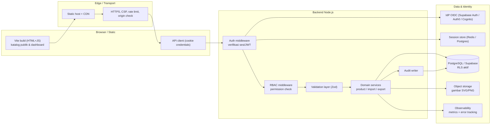
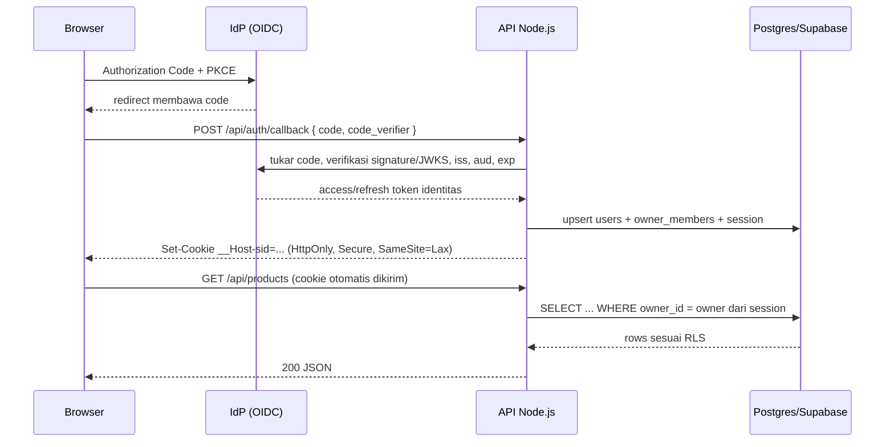
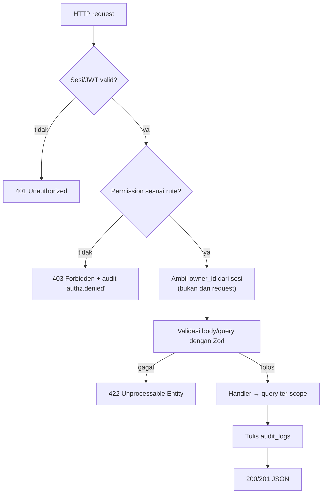
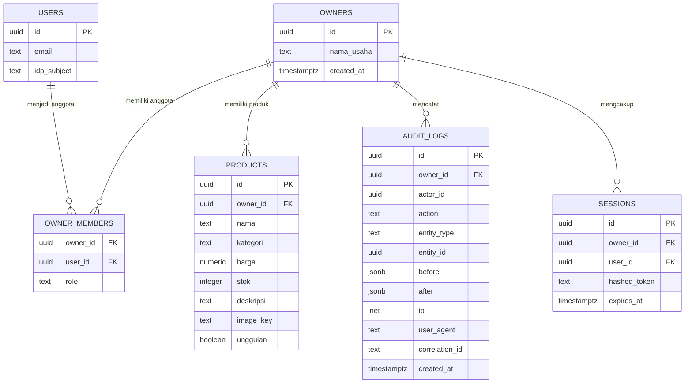

# RasaNusa — Arsitektur & Rencana Migrasi localStorage → Backend Node.js + PostgreSQL/Supabase

> **Status: dokumen rencana, bukan implementasi.** Demo `Bakso Enak` di repository ini tetap berjalan tanpa backend, tanpa login, dan tanpa sesi. Tidak ada "login palsu" yang ditambahkan ke frontend: tidak ada array user hardcoded, tidak ada flag `isLoggedIn` di `localStorage`, dan tidak ada pemeriksaan peran di sisi klien yang dijadikan pengaman.

---

## 1. Konteks dan tujuan

Kondisi saat ini:

| Aspek | Demo sekarang |
|---|---|
| Source of truth | `localStorage` key `baksoenak:products:v1` |
| Penulisan | `src/store.js` (satu-satunya akses storage, `try/catch`) |
| Identitas | Tidak ada |
| Otorisasi | Tidak ada; dashboard terbuka (label `DEMO`) |
| Audit | Tidak ada |
| Multi-perangkat | Tidak ada |

Target **RasaNusa**: katalog dan dashboard yang dipakai beberapa pemilik usaha, dengan data tersimpan di server, identitas asli, wewenang yang ditegakkan di server, dan jejak audit.

Tujuan migrasi:

1. Memindahkan *source of truth* dari browser ke PostgreSQL/Supabase.
2. Mengganti identitas anonim dengan autentikasi berbasis OIDC + session cookie yang aman.
3. Menegakkan RBAC dan isolasi data pemilik **di server/database**, bukan di UI.
4. Membuat setiap perubahan dapat diaudit dan dibatalkan secara terkendali.
5. Migrasi bisa dilakukan bertahap dan di-rollback tanpa kehilangan data demo.

---

## 2. Prinsip desain

1. **Server adalah otoritas.** Frontend boleh menyembunyikan tombol, tetapi keputusan izin selalu diambil server.
2. **Deny by default.** Rute baru tidak terbuka sampai diberi izin eksplisit.
3. **Jangan pernah percaya `owner_id`, `role`, atau `user_id` dari body/query.** Semua berasal dari sesi terverifikasi.
4. **Token tidak disimpan di `localStorage`.** Gunakan cookie `HttpOnly`.
5. **Satu tenant = satu `owner_id`.** Baris data tanpa `owner_id` adalah bug, bukan pengecualian.
6. **Audit adalah data, bukan log konsol.** Tulis ke tabel append-only.
7. **Migrasi reversibel.** Setiap fase punya flag mati/hidup dan prosedur rollback.

---

## 3. Arsitektur target



**Alasan pilihan:**

- **Node.js + TypeScript + Fastify/Express** — mudah dipetakan dari modul `main.js`/`store.js` yang sudah ada; adapter storage bisa diganti tanpa mengubah UI.
- **PostgreSQL/Supabase** — transaksi, constraint, dan **RLS** memberi lapisan pertahanan kedua bila ada bug di query layer.
- **Redis** untuk sesi jika ingin pencabutan instan; kalau memakai Supabase Auth, sesi dikelola IdP dan backend hanya memverifikasi JWT.
- **Object storage** untuk gambar; database hanya menyimpan kunci objek, bukan file.

---

## 4. Autentikasi aman dan session cookie

### 4.1 Alur



### 4.2 Atribut cookie

| Atribut | Nilai | Fungsi |
|---|---|---|
| `HttpOnly` | ya | JS tidak bisa membaca cookie → token tidak bocor lewat XSS |
| `Secure` | ya | Cookie hanya dikirim via HTTPS |
| `SameSite` | `Lax` (default) atau `Strict` bila semua alur same-site | Melindungi dari CSRF lintas site |
| `Path` | `/` | Sesai untuk seluruh API |
| `Max-Age` | idle 30 menit, absolut 8 jam | Batas umur sesi |
| Prefix | `__Host-` | Memaksa `Secure`, `Path=/`, tanpa `Domain` |
| `Domain` | tidak di-set | Mencegah cookie tertulis ke subdomain lain |

Rotasi sesi dilakukan setiap login dan saat refresh; **reuse detection** pada refresh token mencabut seluruh sesi jika terdeteksi pemakaian ulang. Logout mencabut sesi di server dan menghapus cookie, bukan hanya di frontend.

### 4.3 CSRF & lapisan tambahan

- `SameSite` bukan satu-satunya pertahanan: semua mutasi (`POST/PATCH/DELETE`) tetap memeriksa **Origin** terhadap allowlist dan menyertakan token CSRF (double-submit atau signed token di header).
- CORS: `Access-Control-Allow-Origin` hanya origin aplikasi, `credentials: true` hanya untuk origin itu.
- Header keamanan: `Content-Security-Policy`, `X-Content-Type-Options: nosniff`, `Referrer-Policy: no-referrer`, HSTS.
- Rate limit pada login, callback, import, dan export.

### 4.4 Yang tidak boleh muncul di frontend

```js
// DILARANG dalam migrasi RasaNusa:
localStorage.setItem('token', jwt);          // token di storage
const user = { role: 'owner' };              // peran hardcoded
if (localStorage.getItem('loggedIn')) ...    // login palsu
```

Frontend hanya boleh: mengarahkan ke IdP saat user memilih "Masuk", memanggil `/api/me` untuk menampilkan identitas, dan menampilkan/menyembunyikan kontrol sebagai **UX**, bukan sebagai pengaman.

---

## 5. RBAC di server

### 5.1 Matriks wewenang

| Permission | `owner` | `admin` | `staff` | `viewer` |
|---|:---:|:---:|:---:|:---:|
| `product:read` | ✓ | ✓ | ✓ | ✓ |
| `product:write` | ✓ | ✓ | ✓ | – |
| `product:delete` | ✓ | ✓ | – | – |
| `catalog:export` | ✓ | ✓ | – | – |
| `catalog:import` | ✓ | – | – | – |
| `member:invite` / `member:role` | ✓ | – | – | – |
| `audit:read` | ✓ | – | – | – |

Peran disimpan di `owner_members` (database), **bukan** hanya di JWT. Klaim JWT diverifikasi, lalu peran segar dibaca dari DB saat otorisasi agar pencabutan peran langsung berlaku.

### 5.2 Rute dan urutan middleware



Contoh pemetaan: `GET /api/products` → `product:read`; `POST /api/products` → `product:write`; `DELETE /api/products/:id` → `product:delete`; `POST /api/catalog/import` → `catalog:import`.

---

## 6. Isolasi data pemilik dan kebijakan RLS

### 6.1 Model data



### 6.2 Aturan query

- Setiap statement domain menyertakan `WHERE owner_id = $ownerId`.
- `ownerId` diambil dari sesi/klaim terverifikasi, bukan dari parameter URL, body, atau header yang bisa diubah user.
- Endpoint detail memakai `WHERE id = $id AND owner_id = $ownerId`. Jika tidak cocok → **404**, bukan 403, agar tidak memberi tahu keberadaan resource tenant lain.
- Import/export juga ter-scope: export hanya mengambil baris milik owner aktif; import menolak `owner_id` dari file dan selalu menimpa dengan nilai sesi.
- Gunakan prepared statement / parameterized query. Dilarang menyusun SQL dengan string interpolation.

### 6.3 RLS di Supabase/PostgreSQL

RLS bukan pengganti otorisasi aplikasi, melainkan **pertahanan kedua**.

```sql
ALTER TABLE products ENABLE ROW LEVEL SECURITY;
ALTER TABLE audit_logs ENABLE ROW LEVEL SECURITY;

CREATE POLICY products_owner_isolation ON products
  FOR ALL
  USING (
    owner_id IN (
      SELECT owner_id FROM owner_members
      WHERE user_id = auth.uid()
    )
  )
  WITH CHECK (
    owner_id IN (
      SELECT owner_id FROM owner_members
      WHERE user_id = auth.uid()
    )
  );
```

Catatan penting:

- Jika backend memakai **service role key**, RLS dilewati. Itu bukan masalah bila repository layer selalu memakai `owner_id` dari sesi, tetapi risikonya tinggi. Alternatif yang lebih aman: backend meneruskan JWT user ke Postgres atau men-set GUC misalnya `SET LOCAL app.current_user_id = ...`, lalu policy memakai `current_setting('app.current_user_id')`.
- Berikan grant minimum: peran aplikasi hanya `SELECT/INSERT/UPDATE/DELETE` pada tabel domain; tidak boleh `ALTER`, `TRUNCATE`, atau membaca tabel tenant lain.
- Uji RLS dengan dua owner: token A tidak boleh melihat/mengubah baris B, baik lewat API maupun akses PostgREST langsung.

---

## 7. Audit log

### 7.1 Isi

| Field | Tujuan |
|---|---|
| `owner_id`, `actor_id` | Siapa melakukan, di tenant mana |
| `action` | `product.create`, `product.update`, `product.delete`, `catalog.import`, `auth.login`, `authz.denied`, `member.role_changed` |
| `entity_type`, `entity_id` | Objek yang berubah |
| `before`, `after` | Diff ringkas (redaksi field sensitif) |
| `ip`, `user_agent` | Konteks perangkat |
| `correlation_id` | Menyambung log API dengan log audit |
| `created_at` | Waktu kejadian (UTC) |

### 7.2 Integritas

- Tabel bersifat **append-only**: peran aplikasi tidak diberi `UPDATE`/`DELETE`; gunakan trigger yang menolak perubahan baris lama.
- Opsi tambahan: kolom `prev_hash`/`hash` berupa rantai SHA-256 untuk deteksi manipulasi.
- Retention misalnya 12 bulan; penghapusan dilakukan oleh job terpisah dengan izin khusus dan dicatat.
- Jangan simpan kata sandi, token, cookie, atau data pribadi yang tidak perlu di `before`/`after`.

Setiap handler mutation menulis audit dalam **transaksi yang sama** dengan perubahan data, sehingga gagal tulis audit → gagal transaksi.

---

## 8. Input validation

### 8.1 Aturan yang dipertahankan dari demo

Berasal dari `validateProduct()` di `src/products.js`, kini ditegakkan ulang di server (Zod):

| Field | Aturan server |
|---|---|
| `nama` | string, trim, 3–80 karakter, wajib |
| `kategori` | enum: `Makanan Utama`, `Snack`, `Minuman`, `Dessert` |
| `harga` | number, `>= 0`, boleh desimal; tolak `NaN`/`Infinity` |
| `stok` | integer, `>= 0` |
| `deskripsi` | string, trim, 5–200 karakter |
| `imageUrl` / `image_key` | hanya path/kunci lokal, allowlist ekstensi `.svg`/`.png`/`.webp` |
| `unggulan` | boolean |

### 8.2 Lapisan lain

- Validasi `Content-Type`, ukuran body, dan jumlah baris import (misalnya maksimal 1.000 produk per file).
- Import memakai skema array yang sama dengan `parseProductsJson()` saat ini, ditambah pengecekan `id` duplikat dan **mengabaikan** `owner_id` dari file.
- Upload gambar: cek MIME **dan** magic bytes, batasi ukuran, simpan dengan kunci `owner_id/<uuid>.<ext>`, never trust original filename.
- Respons error konsisten: `422` + field errors, `401`, `403`, `404`, `409` untuk konflik; tidak pernah mengembalikan stack trace.
- Escape saat render; parametrized query; CSP untuk membatasi XSS.

---

## 9. Rencana migrasi bertahap

| Fase | Nama | Deliverable | Exit criteria |
|---|---|---|---|
| 0 | Pembekuan scope | Inventaris key `baksoenak:products:v1`, field, dan semua titik CRUD; konfirmasi nama produk `RasaNusa` | Skema data lama terdokumentasi, fixture siap |
| 1 | Schema & keamanan DB | Tabel `owners/users/owner_members/products/audit_logs/sessions`, RLS, peran DB, migrasi SQL | Dua owner diuji; RLS menolak akses silang |
| 2 | Backend fondasi | Fastify/Express + TS, health check, auth middleware, RBAC, Zod, error handler, audit writer | 401 tanpa sesi, 403 peran salah, 422 input invalid |
| 3 | API domain | `GET/POST/PATCH/DELETE /products`, `POST /catalog/export`, `POST /catalog/import`, `GET /me` | Semua rute ter-scope `owner_id`; audit tertulis |
| 4 | Backfill data | Script baca JSON hasil **Ekspor JSON** demo → validasi → insert dengan `owner_id` demo | Checklist jumlah produk, checksum, dry-run sukses |
| 5 | Shadow run | Demo tetap pakai localStorage; backend dijalankan paralel, hasil dibandingkan | Selisih 0 selama periode observasi |
| 6 | Cutover frontend | `src/store.js` jadi adapter HTTP: `loadProducts/saveProducts/resetProducts` tetap sama signature | UI tidak berubah; katalog & dashboard memakai API; **tanpa login palsu** |
| 7 | Pensiun localStorage | Hapus penulisan ke `baksoenak:products:v1`, simpan fitur Ekspor sebagai backup | Tidak ada lagi akses `localStorage` untuk produk |
| 8 | Hardening & handover | Runbook, monitoring, backup restore drill, dokumentasi operasional | Restore dari backup berhasil; runbook di tandatangani |

### 9.1 Strategi cutover

- Pakai **feature flag** `DATA_SOURCE=local|api`. Default `local`; ubah ke `api` per lingkungan.
- Adapter di `src/store.js` menjaga interface tetap sama, sehingga `main.js` dan `ui.js` tidak perlu berubah.
- Selama fase shadow, tulis ke dua tempat hanya di lingkungan uji; di produksi **jangan** dual-write agar tidak ada konflik source of truth.
- Rollback: set flag kembali ke `local`, kembalikan build lama, dan pulihkan snapshot DB bila perlu.

### 9.2 Penanganan data demo

Key lama `baksoenak.products.v2`/`baksoenak:products:v1` tidak dimigrasikan otomatis lewat browser. Di lingkungan produksi, pemilik harus memakai tombol **Ekspor JSON** yang sudah tersedia untuk menghasilkan file, lalu admin menjalankan script backfill. Ini sengaja: file yang diekspor sudah melewati validasi `parseProductsJson()`, sehingga kualitas data lebih terjamin.

---

## 10. Pengujian & penerimaan

- [ ] Tidak ada string `login`, `password`, `session`, atau peran hardcoded yang dipakai sebagai pengaman di `src/` frontend.
- [ ] Cookie diverifikasi di DevTools: `HttpOnly`, `Secure`, `SameSite`, `Path=/`, prefix `__Host-`.
- [ ] Token tidak ditemukan di `localStorage`/`sessionStorage` saat login asli.
- [ ] Tanpa cookie → `401`; peran `viewer` mencoba `DELETE` → `403`; session expired → `401`.
- [ ] Owner A tidak bisa `GET/PATCH/DELETE` produk owner B (hasil `404`), baik via API maupun PostgREST.
- [ ] RLS diuji langsung dengan dua JWT berbeda.
- [ ] Import file rusak/duplikat `id`/pangkat `owner_id` ditolak; data lama tidak berubah.
- [ ] Setiap mutasi menghasilkan tepat satu baris `audit_logs` dengan actor dan `owner_id` benar.
- [ ] Log audit tidak bisa di-`UPDATE`/`DELETE` oleh peran aplikasi.
- [ ] Ekspor hanya memuat data owner aktif.
- [ ] `npm run build` sukses dan Console browser 0 error pada alur tanpa login.

---

## 11. Risiko & keputusan

| Risiko | Mitigasi |
|---|---|
| Service role melewati RLS | Repository selalu memakai `owner_id` dari sesi; uji isolasi dua tenant; pertimbangkan JWT/GUC per request |
| CSRF pada endpoint mutasi | `SameSite` + Origin check + token CSRF |
| XSS membaca token | Cookie `HttpOnly`; token tidak pernah masuk storage; CSP ketat |
| Data demo kotor saat backfill | Ekspor JSON tervalidasi + dry-run + checksum |
| Peran berubah tapi JWT lama masih dipakai | Peran dibaca dari DB saat otorisasi, bukan hanya dari klaim |
| Audit log membengkak | Retention + partisi per bulan; ringkas `before`/`after` |
| Cutover gagal | Feature flag + build lama + snapshot DB + latency rendah |
| Frontend menyamar sebagai login | Aturan tegas: tidak ada autentikasi buatan; hanya redirect ke IdP dan `/api/me` |

---

## 12. Ringkasan satu paragraf

RasaNusa memindahkan kepemilikan data dari browser ke PostgreSQL/Supabase: pengguna masuk lewat OIDC/PKCE, backend menetapkan session cookie `__Host-` ber-`HttpOnly`/`Secure`/`SameSite`, semua rute melewati middleware autentikasi → RBAC → validasi Zod → query ber-`owner_id` → penulisan audit. RLS ditambahkan sebagai pertahanan kedua bila akses langsung ke database terjadi. Migrasi dilakukan delapan fase dengan feature flag, backfill dari fitur **Ekspor JSON** yang sudah ada, shadow run, dan rollback.Frontend tidak pernah mengimplementasikan login palsu; ia hanya mengarahkan ke IdP dan menampilkan data yang diberikan server.
